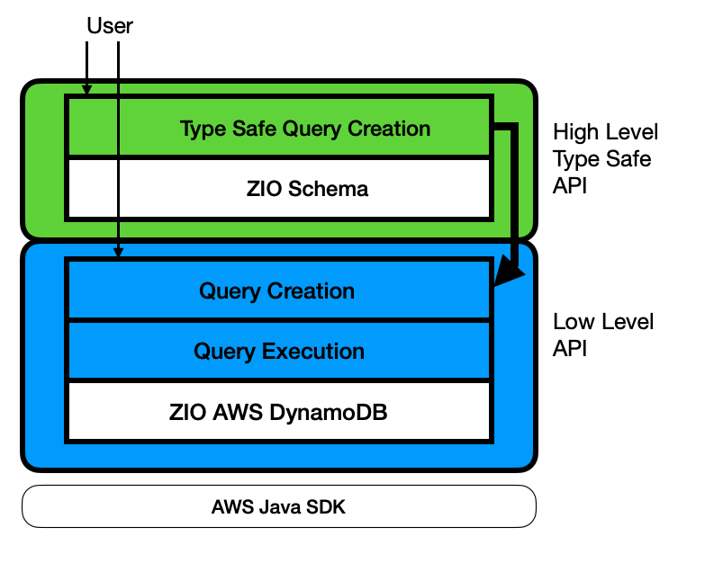

ZIO DynamoDB is built in layers, and each layer depends only on the one below it. The diagram shows the layers and the libraries they use:

The **High Level API** (green) works with our case classes and sealed traits. It uses [ZIO Schema](https://zio.dev/zio-schema/) to derive codecs at compile time and to generate typed `ProjectionExpression`s, and it translates every call into the Low Level API. The **Low Level API** (blue) works with DynamoDB abstractions such as `AttributeValue` and `Item`. It builds `DynamoDBQuery` values, and the `DynamoDBExecutor` runs them with [ZIO AWS](https://zio.dev/zio-aws/), which wraps the AWS SDK for Java v2.

Both APIs produce the same `DynamoDBQuery` type, so they can be mixed in one program. The High Level API is the recommended way to use the library: it is type-safe and removes most of the boilerplate of encoding and decoding items. See [High Level API](high-level-api.md) and [Low Level API](low-level-api.md) for how each one works.
